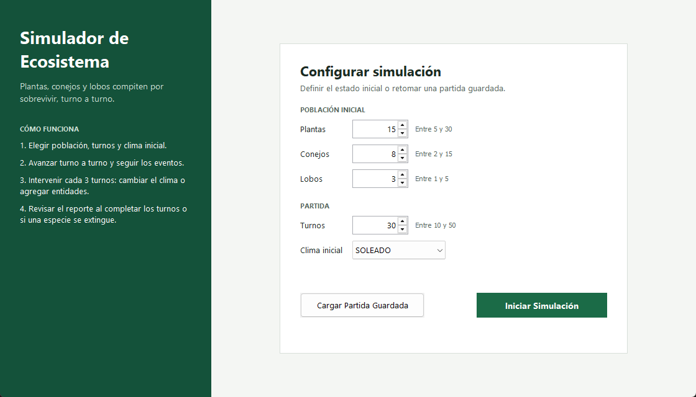
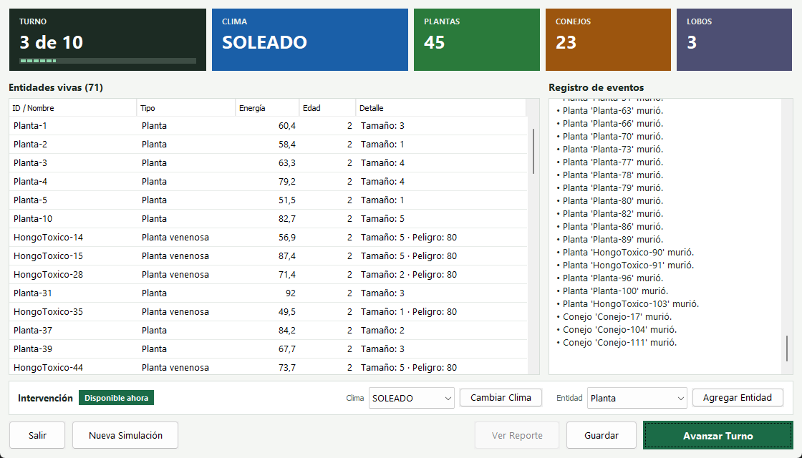
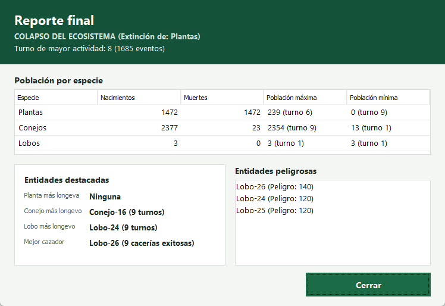

# Simulador de Ecosistema — Versión Swing (MVC + DAO)

Proyecto desarrollado para la **Segunda Instancia Evaluativa** de Interfaz Gráfica (IES).
Transformación del simulador de ecosistema de terminal a una aplicación de escritorio con interfaz gráfica en Java Swing, arquitectura MVC desacoplada y persistencia mediante DAO en archivos de texto plano (.txt).

---

## 👥 Integrantes del Grupo

| Integrante | Rol Principal | Responsabilidades |
| :--- | :--- | :--- |
| **Ferreyra** | Modelo y Lógica de Negocio | Refactorización de entidades de IE1, desacople de consola, gestión de eventos del turno y cálculo de métricas finales. |
| **Allasia** | Persistencia y DAO | Diseño e implementación de `EcosistemaDAO`, lectura/escritura en texto plano (.txt), manejo de I/O y control de excepciones. |
| **Sosa** | UX/UI y Vistas Swing | Diseño UX/UI, construcción de formularios en NetBeans GUI Builder (`.form`) y navegación visual. |

---

## 🏗️ Arquitectura del Sistema

El proyecto sigue un patrón **MVC (Modelo-Vista-Controlador)** con una capa independiente de persistencia **DAO**, organizado en los siguientes paquetes:

* `modelo`: Contiene la jerarquía de entidades (`Entidad`, `Animal`, `Conejo`, `Lobo`, `Planta`, `PlantaVenenosa`), interfaces (`Reproducible`, `Peligroso`, `Mortal`), el enumerador `Clima` y la clase de gestión `GestorEcosistema`. Libre de dependencias de interfaz o entrada/salida de usuario.
* `dao`: Contiene `EcosistemaDAO`, responsable exclusivo de la lectura y escritura del estado de la simulación en formato plano `.txt`.
* `vista`: Formularios diseñados con el **Diseñador Visual de NetBeans** (`.form`). No contiene lógica de simulación ni llamadas a archivos; únicamente captura eventos y los delega al controlador.
* `controlador`: `EcosistemaController`, intermediario que orquesta el flujo entre la Vista, el Modelo y el DAO.
* `principal`: `EcosistemaMVC`, clase que contiene el punto de entrada (`main`), instancia las piezas, las conecta y despliega la aplicación.

---

## 🚀 Requisitos e Instrucciones de Ejecución

* **JDK:** Java SE Development Kit 17 o superior.
* **IDE:** Apache NetBeans 17 o superior.
* **Librerías:** Únicamente bibliotecas estándar de Java (Java Standard Edition / Swing). No requiere dependencias externas ni Maven.

### Pasos para ejecutar:
1. Clonar el repositorio:
   ```bash
   git clone https://github.com/franferreyradev/simulador-ecosistema-swing.git
   ```
2. Abrir **Apache NetBeans**.
3. Ir a `File -> Open Project...` y seleccionar la carpeta del proyecto clonado.
4. Presionar `F6` o hacer clic derecho en el proyecto y seleccionar `Run`.

---

## 🎨 Diseño UX/UI

| Configuración | Simulación | Reporte final |
| :---: | :---: | :---: |
|  |  |  |

### Decisiones de diseño

1. **Jerarquía visual en el dashboard:** un panel superior fijo muestra turno, clima y población en tarjetas de alto contraste, con números grandes y un color por categoría (contraste mínimo WCAG AA de 4.5:1). El estado biológico se lee de un vistazo en cada turno, y una barra de progreso indica cuánto falta para terminar.
2. **Distribución espacial con separación de foco:** el centro está dedicado a la tabla de entidades vivas, ordenable por cualquier columna, y el panel derecho con scroll al registro cronológico de eventos, agrupado por turno. El estado actual ("qué hay") queda separado de la historia ("qué pasó").
3. **Prevención de errores y confirmación (heurísticas de Nielsen):** "Nueva Simulación" y "Salir" piden confirmación si hay una partida en curso, y "Cancelar" es la opción por defecto. La intervención permanece visible, pero solo se habilita cada 3 turnos y una etiqueta informa su estado. Los rangos válidos se muestran junto a cada campo, los selectores numéricos no admiten valores fuera de rango y "Lobo" deja de ofrecerse al alcanzar el cupo.

### Criterios complementarios

* **Jerarquía de acciones:** una sola acción primaria por pantalla, destacada en color y activable con `Enter`. "Salir" queda en el extremo opuesto de "Avanzar Turno" para evitar clics accidentales.
* **Accesibilidad:** atajos de teclado (`Alt` + letra) en todos los botones, etiquetas asociadas a sus campos y descripciones emergentes.
* **Implementación:** todas las pantallas están en `.form` con `BorderLayout` y `GridBagLayout`, sin `AbsoluteLayout`, y se adaptan al redimensionar la ventana.

---

## 📹 Video Explicativo

* **Enlace al video:** *(Insertar link del video de 10 a 15 minutos aquí)*

---

## 🤖 Uso de Inteligencia Artificial y Documentación

Las capturas y enlaces correspondientes a las sesiones y consultas realizadas a modelos de IA para asistencia en arquitectura, patrones y documentación se encuentran organizadas en la carpeta [`documentacion/`](documentacion/).
